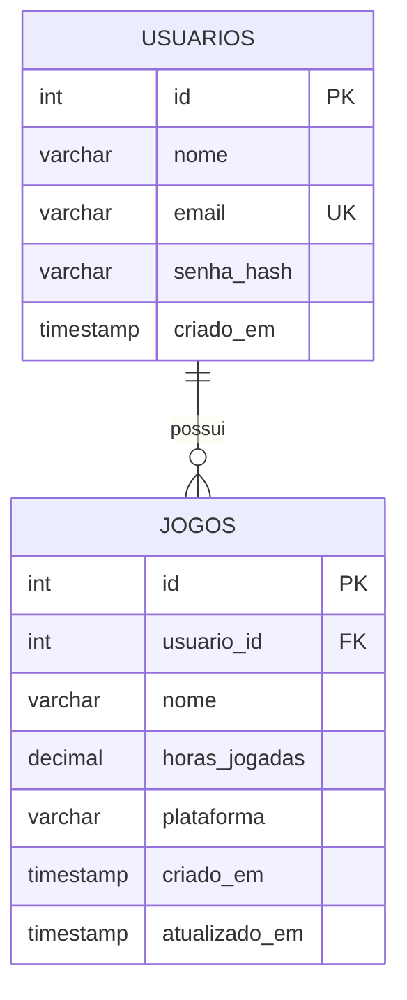

# Dashboard Gamer — Panorama atual e roadmap

> Atualizado em **12/11/2026**. Este documento resume o estado do projeto e organiza as próximas etapas. Os detalhes técnicos estão nos READMEs de [`backend/`](../backend/README.md) e [`frontend/`](../frontend/README.md).

O Dashboard Gamer já passou da fase de projeto puramente frontend: hoje é uma aplicação **Full Stack publicada**, com CRUD integrado a um banco remoto e hospedagem em serviços separados. A próxima fase deve evoluir a qualidade do código, a segurança, a experiência do usuário e as funcionalidades, **sem adicionar tecnologias desnecessárias antes da hora**.

---

## 1. Arquitetura atual

| Camada | Serviço | Tecnologia | Endereço |
|---|---|---|---|
| Frontend | Netlify | HTML + CSS + JavaScript (ES Modules) | `dashboardgamer.netlify.app` |
| Backend | Render | Node.js + Express 5 + `mysql2` (TLS) | `dashboard-gamer.onrender.com` (`/api/jogos`) |
| Banco | TiDB Cloud | MySQL compatível | database `dashboardgamer` |

```text
Navegador (Netlify) ──fetch + CORS──► API Express (Render) ──mysql2 + TLS──► TiDB Cloud
```

O frontend **não acessa o banco diretamente**: todas as operações passam pela API.

---

## 2. O que já está implementado

| Área | Funcionalidade | Situação |
|---|---|---|
| Frontend | Login visual | Implementado |
| Frontend | Cadastro, listagem, edição e exclusão de jogos | Implementado |
| Frontend | Pesquisa por nome | Implementado |
| Backend | API REST com CRUD completo | Implementado e testado em produção |
| Backend | Validação de dados (corpo, ID no `PUT`, campos) | Implementado |
| Backend | Scripts `start`/`dev`, porta via `PORT`, TLS (`DB_SSL`) | Implementado |
| Banco | Persistência MySQL (TiDB Cloud) | Implementado |
| Deploy | Frontend (Netlify), backend (Render), banco (TiDB Cloud) | Publicado |
| Segurança | **CORS restrito** (`origensPermitidas`) | **Configurado** |
| Segurança | Autenticação e autorização | Pendente (Etapa 4) |

### Resolvido recentemente

- CORS restrito às origens do frontend (Netlify e `localhost:5500`);
- Correção do `POST /api/jogos` (validação do corpo da requisição);
- Validação do corpo e do ID também no `PUT`;
- Redirecionamento do login para `dashboard/dashboard.html` (em `auth.js`);
- Scripts `start` e `dev`, e porta configurável (`PORT`);
- Remoção do `storage.js` e correção do rótulo `XOBX ONE`;
- Lista de plataformas ampliada.

### Como está o login?

O login ainda é **apenas uma identificação visual**: recebe nome e e-mail, salva no `localStorage` e redireciona para o dashboard. Não existe senha, sessão ou autorização. O CORS limita quais **sites** podem chamar a API pelo navegador, mas **não protege os dados**: qualquer pessoa que conheça a API (via `curl`, Postman etc.) pode consultar e modificar os jogos. Isso é tratado na Etapa 4.

---

## 3. Próximas implementações

### Etapa 1 — Estabilização e qualidade do código

**Prioridade alta.** Consolidar o que já existe antes de adicionar funcionalidades.

| ID | Implementação | Objetivo | Situação |
|---|---|---|---|
| QL-01 | Validar CORS em produção | Aceitar somente as origens configuradas | ✅ Concluído |
| QL-02 | Melhorar tratamento de erros | Mostrar mensagens de erro na interface | Pendente (cadastro e edição só logam no console) |
| QL-03 | Revisar validações | Frontend e backend validarem os mesmos campos | Parcial (nome: 50 × 120 caracteres; sem limite superior de horas) |
| QL-04 | Refatorar `jogosService.js` | Separar regras de negócio das operações HTTP e SQL | Pendente (arquivo vazio) |
| QL-05 | Criar middleware de erros | Centralizar o tratamento de exceções do Express | Pendente |
| QL-06 | Revisar variáveis de ambiente | Eliminar URLs e configurações espalhadas pelo código | Parcial (backend usa `.env`; `API_URL` e origens do CORS ainda fixas no código) |
| QL-07 | Adicionar testes | Verificar o comportamento dos endpoints | Pendente |

Ajustes menores desta etapa: preencher `DB_NAME` e `PORT` no `.env.example`, corrigir `main`/`license` no `package.json`, ajustes no login (`action`, `name="sername"`, link do LinkedIn), remover `console.log` de depuração e preencher o `CONTRIBUTING.md`.

### Etapa 2 — Dashboard funcional e estatísticas

**Prioridade alta.** A seção visual de XP, nível, conquistas e estatísticas ainda precisa ser implementada (`render.js` tem apenas funções vazias).

| Bloco | Conteúdo |
|---|---|
| Estatísticas gerais | Total de jogos, total de horas, média de horas por jogo, plataforma com mais jogos |
| XP e níveis | XP calculado pelas horas jogadas, nível do jogador, barra de progresso, atualização automática após alterações |
| Conquistas | Primeiro jogo cadastrado, 100 horas jogadas, 10 jogos cadastrados, marcos de progressão |

Decisão importante: essas estatísticas podem ser **calculadas a partir dos jogos cadastrados**, sem criar novas tabelas neste primeiro momento.

### Etapa 3 — Melhorias de gerenciamento dos jogos

**Prioridade média.**

| Funcionalidade | Descrição |
|---|---|
| Filtro por plataforma | A API já aceita `plataforma`; falta a interface |
| Ordenação | A-Z, Z-A (a API já aceita `ordem`), mais horas, menos horas |
| Favoritos | Marcar jogos como favoritos |
| Capa dos jogos | Associar uma imagem a cada jogo |
| Status | Planejado, jogando, concluído, abandonado |
| Histórico | Registrar alterações de horas jogadas |

Hoje só o total de horas é registrado. Futuramente, registrar **sessões de jogo** e calcular o total automaticamente exigiria uma nova estrutura de dados.

### Etapa 4 — Autenticação real e usuários

**Prioridade alta antes de abrir o projeto para outras pessoas.** Hoje todos compartilham a mesma biblioteca.

Estrutura proposta:



Também será necessário:

1. Cadastro de usuários;
2. Login com senha protegida (bcrypt);
3. Autenticação com sessão ou JWT;
4. Middleware de autenticação;
5. Verificação de propriedade dos jogos;
6. Proteção das rotas da API.

> Não basta adicionar `usuario_id` à tabela: o backend precisa **garantir que um usuário não acesse, edite ou exclua jogos de outra pessoa**.

### Etapa 5 — Melhorias visuais e experiência do usuário

**Prioridade média.** Layout responsivo (desktop, tablet e celular), gráficos (horas por plataforma e distribuição da biblioteca), cards aprimorados (capas, status, favoritos) e feedback visual (notificações, modais, estados de carregamento). Tudo isso é possível com HTML, CSS e JavaScript puro; React não é necessário agora.

### Etapa 6 — Recursos avançados

**Futuro.** Integração com API externa de jogos (capas e descrições), perfil público, compartilhamento da biblioteca, comparação entre jogadores, gráficos de evolução das horas, exportação em CSV/PDF, notificações de conquistas e integração com serviços como Steam, se houver API adequada.

---

## 4. Roadmap recomendado

1. ~~CORS e deploy~~ **(concluído)**;
2. **Concluir a estabilização** — erros na interface, validações, `services`, middleware de erros, configuração por ambiente e testes *(próxima etapa)*;
3. Implementar estatísticas e XP;
4. Melhorar o gerenciamento da biblioteca (filtros, ordenação, favoritos, status);
5. Implementar autenticação real;
6. Redesenhar a interface;
7. Expandir as funcionalidades.

---

## 5. Estrutura de diretórios a buscar no futuro

Não precisa ser implementada agora; é uma organização mais madura para o backend:

```text
backend/
└── src/
    ├── config/
    │   └── database.js
    ├── routes/
    │   ├── jogosRoutes.js
    │   └── usuariosRoutes.js
    ├── controllers/
    │   ├── jogosController.js
    │   └── usuariosController.js
    ├── services/
    │   ├── jogosService.js
    │   └── usuariosService.js
    ├── middlewares/
    │   ├── autenticar.js
    │   └── tratarErros.js
    ├── repositories/
    │   ├── jogosRepository.js
    │   └── usuariosRepository.js
    ├── utils/
    │   └── validar.js
    └── server.js
```

A camada `repositories` é opcional: separa as consultas SQL das regras de negócio. Vale adicioná-la só depois de entender bem a responsabilidade de cada camada.

---

## 6. Avaliação do projeto

| Critério | Estado atual |
|---|---|
| Fundamentos frontend | Em desenvolvimento |
| Manipulação do DOM | Implementada |
| Módulos JavaScript | Implementados |
| Fetch e comunicação HTTP | Implementados |
| API REST | Implementada |
| Node.js e Express | Implementados |
| MySQL e persistência | Implementados |
| CRUD Full Stack | Funcionando em produção |
| Deploy | Realizado |
| CORS | Configurado |
| Segurança (autenticação) | Básica, precisa evoluir |
| Testes automatizados | Ainda precisam ser estruturados |
| Estatísticas e gamificação | Pendente |
| Multiusuário | Pendente |

O principal resultado já alcançado: uma aplicação publicada que conecta frontend, backend e banco remoto, com CORS configurado.

**Recomendação:** não começar React, Docker ou outras tecnologias agora. Primeiro consolide o projeto atual.

**Próximo passo concreto:** concluir a Etapa 1 (começando por mostrar erros na interface e alinhar as validações) e, em seguida, implementar estatísticas e XP.